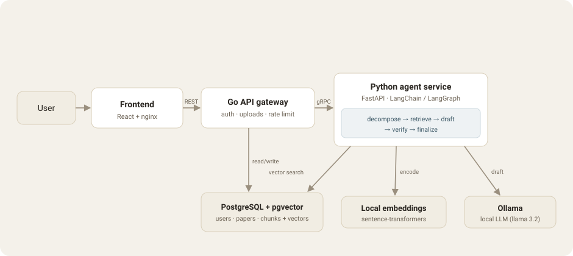

# CiteGraph

CiteGraph lets you upload research papers and ask questions about them. Every
citation in the answer is checked against the passage it points to, and if the
papers don't cover the question, it says so instead of making something up.

A lot of "chat with your PDFs" tools attach citations without checking if the
cited text actually supports the claim. I wanted to fix that. CiteGraph drafts
an answer with a small local model, checks each citation separately, and drops
anything it can't back up. Everything runs locally with Ollama, local
embeddings, and Postgres + pgvector in Docker, so there are no API keys or
paid services.

## How citations are checked

The model that writes the answer doesn't get to check its own work.

The draft uses `[n]` markers that point to the numbered passages it was given.
For each cited sentence, a separate step decides whether the passage supports
the claim. It uses a small logistic regression classifier with a few features:
embedding similarity, keyword overlap, number overlap, and text length. If all
of a sentence's citations fail, the sentence is removed. If nothing is left,
the answer becomes "not found".

To test this I labeled 48 claim/passage pairs by hand, half supported and half
not. The verifier gets 94% precision with an F1 of 0.81, compared to 66%
precision and an F1 of 0.75 for a plain similarity threshold. I also tested 25
questions the papers can't answer, and it refused 24 of them. The full results
are in [`eval/results.md`](eval/results.md) and the app's Evaluation tab, and
you can rerun them with `make eval`.

## Architecture



The frontend talks to a Go gateway over REST. The gateway handles accounts,
uploads, and rate limiting, and sends the AI work to a Python agent over gRPC.
The agent runs the pipeline, stores text and vectors in Postgres with pgvector,
creates embeddings locally, and uses Ollama to write the draft.

## Tech stack

| Part | Tech |
|---|---|
| Frontend | React, Vite, nginx |
| API gateway | Go, chi, JWT, gRPC |
| Agent service | Python, FastAPI, LangChain, LangGraph |
| Embeddings | sentence-transformers |
| LLM | Ollama with llama3.2 3B |
| Database | PostgreSQL + pgvector |
| PDF parsing | PyMuPDF |
| Citation verifier | scikit-learn |
| Dev / CI | Docker Compose, pytest, Go test, GitHub Actions |

## How it works

Each question goes through five steps:

1. **Decompose** - broad questions like "compare X and Y" are split into
   smaller sub-questions. Simple questions are left as they are.
2. **Retrieve** - each sub-question is embedded and the closest chunks are
   pulled from pgvector. If nothing relevant comes back, it stops here.
3. **Draft** - the model writes an answer from the retrieved chunks with `[n]`
   citation markers.
4. **Verify** - each citation is checked and unsupported sentences are removed.
5. **Finalize** - you get the answer, the citations with paper, section, page,
   and confidence score, and how many claims were dropped.

## Running it

You only need Docker Desktop.

```bash
git clone https://github.com/vppatel4/CiteGraph.git
cd CiteGraph
cp .env.example .env
docker compose up --build
```

Open http://localhost:5173 and log in with the demo account:

```
demo@citegraph.dev  /  demo1234
```

You can also create your own account from the login screen.

The first run downloads an embedding model of about 90 MB and the
`llama3.2:3b` model of about 2 GB, so it takes a few minutes. The status dot in
the top bar changes from "warming up" to "ready" when it's done.

| Service | URL |
|---|---|
| App | http://localhost:5173 |
| Gateway API | http://localhost:8080 |
| Agent health | http://localhost:8000/health |
| Postgres | localhost:5432 |
| Ollama | http://localhost:11434 |

Ports can be changed in `.env`. Run `docker compose down` to stop, or
`docker compose down -v` to also delete the database and downloaded models.

## Try it

1. Log in with the demo account.
2. Drag two or three research papers onto the sidebar and wait for them to
   finish processing.
3. Ask something specific, like "What methods do these papers use to reduce
   false positives?"
4. Check the citations. Each one shows the paper, section, page, the passage it
   was checked against, and a confidence score.
5. Ask something the papers don't cover, like "What is the capital of France?",
   and it should refuse to answer.
6. Open the Evaluation tab to see the verifier results.
