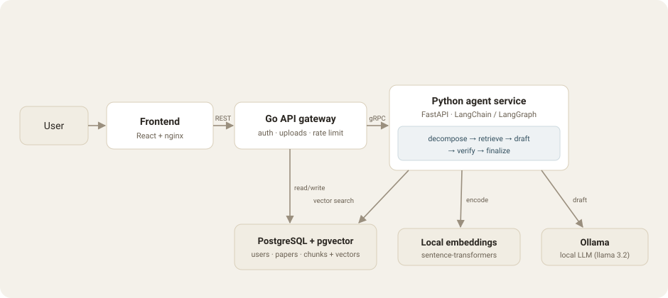

# CiteGraph

Ask a question across a stack of research papers and get an answer where every
citation is checked against its source before you see it — and where the app says
"the provided papers don't address this" instead of making something up.

Most "chat with your PDFs" tools staple a citation onto an answer whether or not
the cited passage actually says what the answer claims. CiteGraph does the
opposite: it drafts an answer with a small local model, then checks each citation
on its own, drops any claim it can't back up, and refuses when the papers don't
cover the question. Everything runs locally and free — a local LLM through
Ollama, local embeddings, and Postgres + pgvector in Docker. No API keys, no
sign-ups, no cloud.

## How it checks every citation

The interesting part is that the language model never gets to grade its own work.

The draft comes back with inline `[n]` markers pointing at the numbered passages
it was given. For each cited sentence, a separate step measures whether the cited
passage really supports the claim — using the embedding similarity between the
two plus a tiny logistic-regression classifier (embedding similarity, keyword
overlap, numeric overlap, and lengths). A sentence whose citations all fail is
removed; if nothing survives, the whole answer becomes an honest "not found".

I measured how well that check works on a hand-labeled set of 48
`(claim, passage, verdict)` pairs (half supported, half not, including passages
that look similar but say something different). The classifier scores **F1 0.82**
against **0.75** for a plain similarity threshold — mostly by not being fooled on
precision (0.80 vs 0.66). On a separate set of 10 questions the papers can't
answer, it refused all 10 (a 0% false-answer rate). The numbers live in
[`eval/results.md`](eval/results.md) and in the app's Evaluation tab, and you can
regenerate them with `make eval`.

## Architecture diagram



The browser talks to a Go gateway over REST. The gateway owns accounts, uploads,
and rate limiting, and hands the AI work to a Python agent over gRPC. The agent
runs the pipeline, reads and writes Postgres (vectors included, via pgvector),
embeds text locally, and uses Ollama only to draft.

## Tech stack

| Part | Tech |
|---|---|
| Frontend | React + Vite, served by nginx |
| API gateway | Go (chi, JWT auth, gRPC client) |
| Agent service | Python + FastAPI, LangChain + LangGraph |
| Embeddings | sentence-transformers (local) |
| LLM | Ollama — llama 3.2 3B (local) |
| Storage + search | PostgreSQL + pgvector |
| PDF parsing | PyMuPDF |
| Citation verifier | scikit-learn (logistic regression) |
| Dev / CI | Docker Compose, pytest, Go test, GitHub Actions |

## How it works

When you ask a question it runs through five steps:

1. **Decompose** — if the question is broad ("compare X and Y"), the model splits
   it into a couple of focused sub-questions. Simple questions pass through as-is.
2. **Retrieve** — each sub-question becomes a vector, and the most similar chunks
   of your papers come back from pgvector. If nothing is even loosely relevant,
   it stops here and says so.
3. **Draft** — the retrieved chunks and the question go to the local model, which
   writes an answer with `[n]` citation markers and bullets for multi-part asks.
4. **Verify** — each citation is checked independently (see above) and anything
   unsupported is dropped.
5. **Finalize** — you get the verified answer, the surviving citations (paper,
   section, page, and a confidence score), and a count of whatever was dropped.

## Running it

You just need **Docker Desktop** running (no account needed for local use).

```bash
git clone https://github.com/vppatel4/CiteGraph.git
cd CiteGraph
cp .env.example .env
docker compose up --build
```

Then open **http://localhost:5173** and log in with the seeded demo account:

```
demo@citegraph.dev  /  demo1234
```

(or create your own account on the login screen).

On the first run the agent downloads a small embedding model (~90 MB) and pulls
the Ollama model (`llama3.2:3b`, ~2 GB). The dot in the top bar shows **warming
up** until that finishes, then **ready** — give it a few minutes the first time.

| Service | URL |
|---|---|
| App | http://localhost:5173 |
| Gateway API | http://localhost:8080 |
| Agent health | http://localhost:8000/health |
| Postgres | localhost:5432 |
| Ollama | http://localhost:11434 |

Ports are overridable in `.env`. Stop with `docker compose down`, or
`docker compose down -v` to also wipe the database and downloaded models.

## Try it


<!-- Placeholder: record a short screen capture of the flow below and save it as docs/media/demo.gif -->

1. Log in with the demo account above.
2. Drag two or three research-paper PDFs onto the sidebar and wait for them to
   appear with page and chunk counts.
3. Ask something specific, e.g. _"What methods do these papers use to reduce
   false positives?"_
4. Read the answer and look at the citations — each shows the paper, section and
   page, the exact passage it was checked against, a confidence ring, and a
   verified badge.
5. Ask something the papers can't answer, e.g. _"What is the capital of France?"_,
   and watch it refuse instead of guessing.
6. Open the **Evaluation** tab to see the citation-check numbers and the
   cannot-answer rate.
